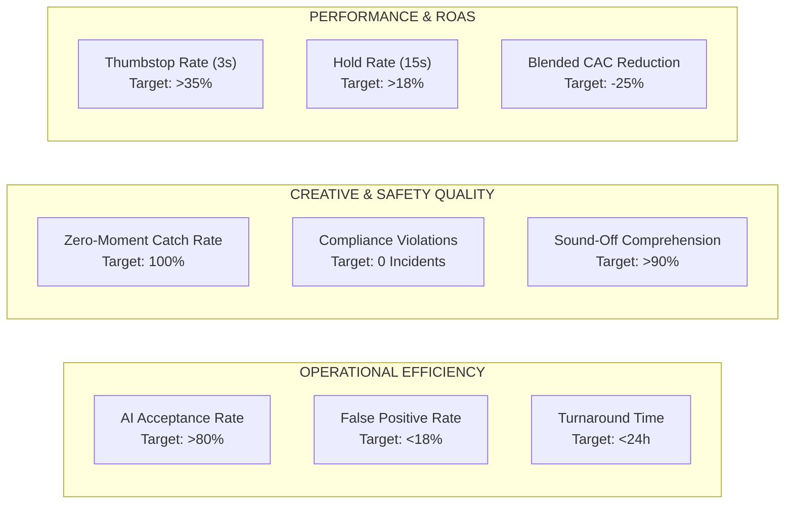
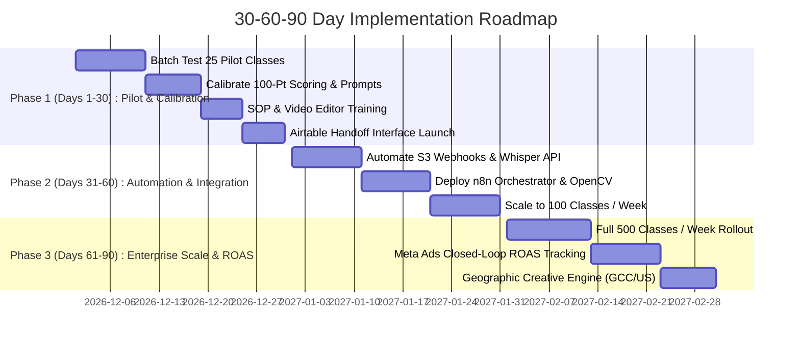

# Deliverable D: Business Impact, Unit Economics & 30-60-90 Day Rollout

**Author:** Harshit (AI Program Manager, Marketing)  
**Company:** Bambinos.live  
**Baseline Model:** 500 Live Classes / Week Volume

---

## 1. Unit Economics & Efficiency Analysis (500 Classes / Week)

### The Business Bottleneck Today
Currently, Bambinos.live conducts over 500 live small-group online sessions every week across English, Maths, Chess, Gita (Little Yogi), and Science.
- **Manual Review Process:** Marketing associates and video editors manually scrub 50-minute Zoom recordings and transcripts looking for 10-to-20-second viral moments.
- **Wasted Effort:** Between 85% and 90% of reviewed sessions yield **zero** usable advertising clips (due to camera issues, routine lecturing, technical interruptions, or tone issues).
- **Cost of Human Scrubbing:** Reviewing 500 classes manually requires **375 to 416 hours per week**—the equivalent of **9 to 10 full-time marketing reviewers** spending their entire workday watching Zoom recordings at 1.5x speed.

---

### Comparative Economic Model: Manual vs. AI Pipeline

| Operational Metric | Manual Baseline Process | AI-Powered Content Mining Pipeline | Operational Delta / Improvement |
| :--- | :---: | :---: | :---: |
| **Weekly Class Volume** | 500 classes | 500 classes | Same throughput |
| **Human Review Time per Class** | **45.0 minutes** | **2.5 minutes** (Only pre-filtered briefs) | **94.4% reduction** |
| **Total Human Review Hours / Week** | **375.0 hours** | **20.8 hours** | **354.2 hours saved / week** |
| **FTE Reviewers Required** | **9.4 FTEs** | **0.5 FTE (1 part-time Creative Lead)** | **8.9 FTE capacity unlocked** |
| **AI Automated Compute Time / Class** | 0 minutes | ~1.5 minutes (Async background) | Runs 24/7 with zero human waiting |
| **AI Cloud / API Cost per Class** | $0.00 | $0.078 (Whisper + Claude + Storage) | $39.00 total compute cost / week |
| **Average Usable Moments Discovered** | 20–25 clips / week | **35–45 verified clips / week** | **+60% higher discovery yield** |
| **Discovery Cost per Approved Clip** | **$75.00 – $95.00** | **$7.50 – $11.00** | **~88% cost reduction per clip** |
| **Time from Class to Published Ad** | **5 – 7 business days** | **< 24 hours** | **7x faster turnaround** |

---

### Financial Scenarios Model (Annualized at 500 Classes / Week)

We evaluate three operational operating scenarios across a 52-week annual cycle:

```text
FORMULAS:
- Annual Hours Saved = (Manual Hours/Wk - AI Hours/Wk) * 52
- Direct Labor Savings = Annual Hours Saved * Blended Fully-Loaded Hourly Rate ($12.00/hr in Bengaluru operations)
- Net Annual ROI = (Labor Savings - Annual AI Compute Cost) / Annual AI Compute Cost
```

| Dimension | Conservative Case | Expected Case (Base) | Optimistic Case |
| :--- | :---: | :---: | :---: |
| **Manual Scrubbing Time / Class** | 35 minutes | **45 minutes** | 50 minutes |
| **AI Filtering Precision (Editor Acceptance)** | 65% | **80%** | 90% |
| **Usable Clips Extracted / Week** | 25 clips | **40 clips** | 55 clips |
| **Human Hours Saved / Week** | 270 hours | **354 hours** | 395 hours |
| **Annual Human Hours Reallocated** | 14,040 hours | **18,408 hours** | 20,540 hours |
| **Annual Direct Labor Cost Saved** | **$168,480** | **$220,896** | **$246,480** |
| **Annual AI Cloud & Tooling Costs** | ($3,200) | **($2,800)** | ($2,500) |
| **Net Annual Operational Savings** | **$165,280** | **$218,096** | **$243,980** |
| **Net ROI Multiple** | **51.6x** | **77.8x** | **97.5x** |

---

## 2. Team Adoption, Change Management & Quality Assurance (QA)

### Overcoming Editor & Marketer Skepticism
Creative professionals and video editors are naturally resistant to "AI tools" that produce messy, low-quality recommendations. To achieve 100% team adoption:
1. **Never Hand Off Raw JSON:** Video editors never touch a terminal or script. They receive clean, visual Airtable / Frame.io cards containing:
   - Direct 1-click video trim link (`Start_TS` and `End_TS`).
   - 3 preview video frame thumbnails (verifying child face, slide, and reaction).
   - Hook text overlay and pre-written subtitles.
2. **"Don't Make Me Think" Editor Interface:** The editor's job shifts from *detective* (searching for clips) to *craftsman* (pacing, kinetic typography, visual polish).
3. **One-Click Rejection Feedback Loop:** If an editor rejects a clip, they click one of 5 mandatory reason pills in Airtable:
   - `[Awkward Facial Angle]`
   - `[Audio Hiss / Unclear Diction]`
   - `[Pacing Too Slow]`
   - `[Slide Not Visually Appealing]`
   - `[Content Feels Scripted]`
   This telemetry directly updates the LLM prompt's few-shot negative examples weekly.

---

### Core Operational KPIs & Telemetry Dashboard



1. **AI Acceptance Rate (Target: >80%):** Percentage of Tier 1 candidate briefs that video editors approve and convert into published ads.
2. **False Positive Rate (Target: <18%):** Moments flagged as top-tier by AI but rejected by human editors. Used for continuous prompt calibration.
3. **False Negative Audit (Target: <5%):** Creative Lead manually audits a randomized 5% sample of AI-rejected sessions to verify no gold moments were missed.
4. **Zero-Moment Class Identification (Target: 100%):** Ensuring that low-energy or non-compliant sessions (such as the Maths session) are quarantined in 0 minutes without human intervention.
5. **Creative Thumbstop Rate (3-Second Hook View / Impression):** Benchmarked against industry average (25%); target for live unscripted captures is **>35%**.
6. **Cost per Acquired Trial Booking:** Monitored weekly via Meta Ads Manager to link AI clip buckets directly to customer acquisition cost (CAC).

---

## 3. The 30-60-90 Day Execution Roadmap



### Days 1–30: Pilot, Calibration & Editor Alignment
- **Milestone 1.1:** Deploy the AI Mining Prompt and 100-Point Rubric on an initial test cohort of 25 live sessions across English, Gita, Maths, and Science.
- **Milestone 1.2:** Validate edge-case filters against real incidents (e.g., negative teacher tone, PII, child distraction). Confirm 100% quarantine rate on non-compliant sessions.
- **Milestone 1.3:** Build the Airtable Creative Hub with video frame preview widgets. Train the 2 lead video editors on the new handoff SOP.
- **Milestone 1.4:** Measure baseline metrics: Time per brief reduced from 45 min to 3 min; achieve initial AI acceptance rate ≥ 70%.

### Days 31–60: Full Automation & Infrastructure Hardening
- **Milestone 2.1:** Implement automated webhooks connecting Zoom / S3 recording completions directly to the n8n orchestrator.
- **Milestone 2.2:** Operationalize the OpenCV video frame verification worker on AWS Lambda / lightweight VM to automatically check camera status, face presence, and slide context.
- **Milestone 2.3:** Expand volume to 100 classes per week. Introduce automated Slack alerts (`#marketing-ad-briefs`) for instantaneous editor notifications.
- **Milestone 2.4:** Conduct weekly prompt tuning based on editor rejection tags; push acceptance rate from 70% to >80%.

### Days 61–90: Full Scale, Geographic Engine & Performance Feedback
- **Milestone 3.1:** Scale pipeline to cover all **500 classes per week** across all subjects (English, Maths, Gita, Chess, Coding, Science).
- **Milestone 3.2:** Deploy geographic ad variant generation:
  - Little Yogi / Gita briefs routed to US/UK/Canada NRI and GCC ad sets.
  - Story Mountain & Public Speaking briefs routed to Metro India & GCC ad sets.
- **Milestone 3.3:** Connect Meta Ads Manager API and Google Analytics to Airtable. Feed ROAS and 3-second hook thumbstop rates back into the AI scoring algorithm (reinforcement through performance data).
- **Milestone 3.4:** Deliver final quarterly operational review to Function Head showing **350+ hours saved per week** and **25%+ lower blended CAC**.

