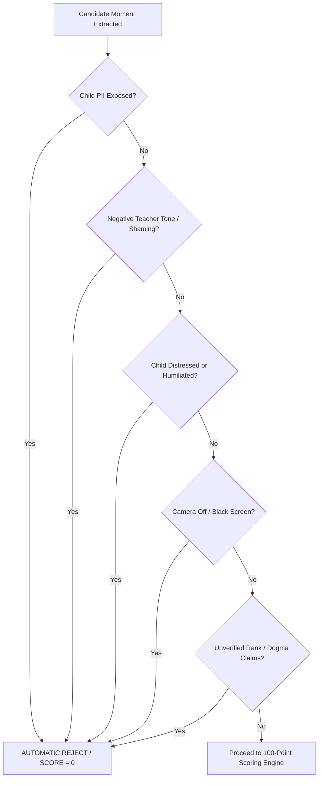

# Deliverable A: Research & Creative Taxonomy Report

**Author:** Harshit (AI Program Manager, Marketing)  
**Company:** Bambinos.live  
**Focus:** Live Class Recording to High-Converting Short-Form Paid Social Pipeline

---

## 1. Executive Summary & Market Landscape

In high-growth EdTech performance marketing, acquiring parents across Metro India, the GCC (UAE/Saudi/Qatar/Kuwait), and the Western NRI Diaspora (US, UK, Canada, Australia) has undergone a fundamental structural shift:
1. **Ad Fatigue with Scripted Testimonials:** Parents are bombarded with polished studio ads, celebrity endorsements, and coached child actors. These ads face diminishing CTRs and high CAC because parents instinctively recognize them as staged marketing scripts.
2. **The "Live Classroom" Secret Weapon:** Bambinos.live's highest-converting ads are authentic, unscripted 10-to-20-second captures from real live classes. When a parent sees a real 6-year-old spontaneously explain a story arc or recite a Sanskrit shloka with genuine joy, it triggers the cognitive pause:
   > *"Something is happening in this class that doesn't happen in my child's regular school."*
3. **The Operational Bottleneck:** Finding these moments manually across 500+ weekly 50-minute classes requires 400+ hours of video scrubbing. 85–90% of reviewed classes contain zero usable ad moments.
4. **The AI Program Mission:** Build an automated, production-grade intelligence pipeline that ingests transcripts and video streams, applies a rigorous 100-point scoring engine, catches safety and tone hazards, and hands editor-ready ad briefs to video creators at **10x operational velocity**.

---

## 2. Competitive Intelligence & Meta Ad Library Audit

To design a winning creative taxonomy, we reverse-engineered the Meta Ad Library, Instagram Reels, and YouTube Shorts strategies of three key competitors: **PlanetSpark**, **Bhanzu**, and **BrightCHAMPS**.

| Competitor | Core Offering & Audience | Primary Meta Ad Library Hooks Observed | Ad Formats & Visual Mechanics | What Bambinos Can Learn | Where Bambinos Differentiates |
| :--- | :--- | :--- | :--- | :--- | :--- |
| **PlanetSpark** | English Communication, Public Speaking, Creative Writing (Ages 4–14) | - *"If your child is shy and hesitates to speak up in school, watch this."* - *"From crying on stage to winning debates in 90 days."* - *"The #1 reason smart kids get passed over for leadership."* | - Dynamic, high-contrast yellow/white word-by-word captions. - Before-and-after split-screen (stumbling child vs fluent speaker). - UGC "Momfluencer" phone-camera style. | Leverage high-contrast kinetic captions for sound-off viewing; frame communication not as an exam subject, but as lifelong confidence. | PlanetSpark frequently relies on parental guilt and FOMO. Bambinos differentiates through **joyful, warm mentorship** and **story-driven creative writing**, avoiding high-pressure sales tactics. |
| **Bhanzu** | Conceptual Mathematics, Speed Math (Ages 6–16) | - *"How is this 7-year-old calculating faster than a calculator?"* (Prodigy Hook) - *"Tired of the daily evening math homework tears?"* (Pain Hook) - *"90% of adults fail this simple mental math puzzle."* (Challenge Hook) | - Split-screen: Traditional rote worksheet vs Bhanzu visual pattern. - Neelakantha Bhanu (World's Fastest Human Calculator) founder authority clips. - Screen captures of kids shouting answers in live group sessions. | Utilize the "Prodigy Hook" and conceptual problem-solving visuals (e.g., bar models) to prove learning in the first 3 seconds. | Bhanzu is strictly math-centric. Bambinos offers a **holistic ecosystem** (Maths, English, Chess, and Bhagavad Gita / Little Yogi) focused on all-round character and intellect. |
| **BrightCHAMPS** | Next-Gen Life Skills: Coding, AI, Robotics, Financial Literacy (Ages 6–16) | - *"By 2030, standard school curricula will be obsolete. Is your child future-ready?"* - *"Turn your child from a gamer into a game developer."* - *"What schools don't teach about money and AI."* | - Gamified screen recordings with dynamic overlays. - Split-screen of child playing Roblox vs coding Python. - Low-friction diagnostic CTAs (*"Book Free Assessment"*). | Frame skills as "future-proofing" and life mastery rather than textbook homework support. | BrightCHAMPS leans heavily into modern tech. Bambinos uniquely bridges **futuristic cognitive skills with timeless values** (Little Yogi track), offering deep cultural resonance for NRI parents. |

---

## 3. Creative Taxonomy: The 6 High-Value Moment Buckets

Rather than blindly clipping dialogue, the pipeline categorizes every candidate into one of 6 battle-tested creative buckets:

```mermaid
graph TD
    classDef b1 fill:#e1f5fe,stroke:#0288d1,stroke-width:2px;
    classDef b2 fill:#e8f5e9,stroke:#388e3c,stroke-width:2px;
    classDef b3 fill:#fff3e0,stroke:#f57c00,stroke-width:2px;
    classDef b4 fill:#f3e5f5,stroke:#7b1fa2,stroke-width:2px;
    classDef b5 fill:#ede7f6,stroke:#512da8,stroke-width:2px;
    classDef b6 fill:#fbe9e7,stroke:#d84315,stroke-width:2px;

    B1["Bucket 1: The Eureka Moment<br>(Cognitive Breakthrough)"]:::b1
    B2["Bucket 2: Student Participation<br>(Conversational Fluency)"]:::b2
    B3["Bucket 3: Interactive Learning<br>(Gamified Discovery)"]:::b3
    B4["Bucket 4: Confidence Transformation<br>(Mindfulness & Composure)"]:::b4
    B5["Bucket 5: Creative Pedagogy<br>(Inspiring Mentorship)"]:::b5
    B6["Bucket 6: Real Learning Demonstration<br>(Cultural & Skill Pride)"]:::b6
```

### Bucket 1: The Eureka Moment (Cognitive Breakthrough)
- **Definition:** The exact instant when a child experiences a sudden cognitive connection—their eyes widen, they smile, or they shout out an answer after struggling with a problem.
- **Why Parents Stop:** Parents long to see their child understand *why*, not just memorize formulas. It validates the superior pedagogy of small-group live coaching.
- **Strong Example:** In English (`Session 2125604619`), child suddenly realizes that resolving the main crisis happens in the *Resolution* phase, not the *Ending*: *"Oh yeah! The resolution! I chose it!"*
- **Weak Example:** Child mindlessly guessing options (A, B, C) until the teacher says "yes".
- **Marketing Angle:** *"When learning clicks, you don't need to force them to study."*
- **Ideal Geography:** Metro India & GCC.

### Bucket 2: Student Participation & Conversational Fluency
- **Definition:** An unscripted moment where a student speaks passionately, expressing imaginative ideas, narrating an experience, or debating a concept using rich vocabulary.
- **Why Parents Stop:** Demonstrates active oral fluency. In traditional schools with 40-student classrooms, shy children never get airtime; here, the child is the center of attention.
- **Strong Example:** In English (`Session 2125604619`), child describing a sensory beach narrative: *"I saw turtles, I saw crabs, I saw a fish, and we were eating salmon!"* with active teacher guidance from present to past tense.
- **Weak Example:** One-word replies ("Yes ma'am", "Okay", "Done").
- **Marketing Angle:** *"Give your child the confidence to speak up without fear."*
- **Ideal Geography:** India (Non-metro to metro transition) & GCC.

### Bucket 3: Interactive Learning & Gamified Discovery
- **Definition:** Fast-paced, gamified activities—interactive digital whiteboards, rapid-fire quizzes, bar-model manipulations, or live science observations.
- **Why Parents Stop:** Proves that screen time can be high-yield, engaging, and joyful rather than passive entertainment (YouTube/tablets).
- **Strong Example:** In Science (`Session 2125687282`), comparing the biological response of a Touch-Me-Not plant closing its leaves to protect itself vs a brittle dry stick snapping.
- **Weak Example:** Teacher reading bullet points off a static text slide for 2 minutes straight.
- **Marketing Angle:** *"Replace mindless scrolling with interactive discovery."*
- **Ideal Geography:** India Metro, US, UK.

### Bucket 4: Confidence Transformation & Mindfulness
- **Definition:** A visible shift in the child’s emotional posture—from hesitation or restlessness to calm focus, deep breathing, and poised participation.
- **Why Parents Stop:** Parental anxiety around child hyperactivity, short attention spans, and exam stress is at an all-time high.
- **Strong Example:** In Gita (`Session 2125422751`), Nancy guiding 6-year-old Anaya through closed-eye breathing meditation: *"Try to focus on your breathing... how are you breathing in and breathing out."*
- **Weak Example:** Teacher repeatedly scolding a distracted student to "sit straight".
- **Marketing Angle:** *"How we teach 6-year-olds to master their focus in a distracted world."*
- **Ideal Geography:** Global (US, UK, Canada, GCC, India).

### Bucket 5: Creative Pedagogy & Inspiring Mentorship
- **Definition:** Moments that highlight the teacher’s extraordinary warmth, patience, storytelling ability, or creative analogy that simplifies a daunting topic.
- **Why Parents Stop:** Parents are not just buying a curriculum; they are buying an exceptional mentor their child loves meeting every week.
- **Strong Example:** Teacher using the mythological journey of Markandeya and Yamraj to explain the psychology of overcoming fear and staying calm.
- **Weak Example:** Teacher lecturing in a monotone voice or reading standard textbook definitions.
- **Marketing Angle:** *"Teachers your child will actually look forward to meeting every week."*
- **Ideal Geography:** India, GCC, US.

### Bucket 6: Real Learning Demonstration & Cultural Pride
- **Definition:** Tangible proof of specialized learning—flawlessly reciting Sanskrit shlokas and explaining their real-world moral meaning, executing mental math shortcuts, or outlining a story structure.
- **Why Parents Stop:** Unmatched emotional resonance for NRI and culturally conscious parents who fear their children are losing connection with Indian heritage and languages.
- **Strong Example:** In Gita (`Session 2125422751`), Anaya flawlessly chanting *"Saraswati Namastubhyam Varade Kama-rupini"* and excitedly explaining: *"Say Namaste to the Goddess and ask for blessings!"*
- **Weak Example:** Rote mechanical chanting without understanding the words or meaning.
- **Marketing Angle:** *"Connecting our children to timeless values, no matter where in the world you live."*
- **Ideal Geography:** US, UK, Canada, Australia, GCC (High NRI density).

---

## 4. Quantitative Scoring Rubric (100-Point Framework)

To systematically eliminate subjectivity, our AI Evaluation Engine scores every candidate across 5 weighted dimensions:

| Dimension | Max Points | Weight | What We Quantify | Scoring Benchmark (High vs Low) |
| :--- | :---: | :---: | :--- | :--- |
| **1. Parent Stopping Power** | 25 | 25% | First 3 seconds visual/verbal hook, curiosity gap, contrast to traditional school. | **21–25:** Immediate visceral intrigue, explosive hook. **0–10:** Slow, mundane classroom admin dialogue. |
| **2. Educational Value Demonstrated** | 25 | 25% | Clear proof of learning, conceptual depth, skill mastery visible to parent. | **21–25:** Tangible skill breakthrough (shloka meaning, story mountain). **0–10:** Rote repetition, trivia, superficial guessing. |
| **3. Audio-Visual Clarity** | 20 | 20% | Webcam centering, lighting, audio SNR, slide resolution, face visibility. | **17–20:** Both faces clear, pristine audio, high contrast. **0–8:** Dark lighting, echo, heavy hiss, webcam off. |
| **4. Emotional Authenticity** | 15 | 15% | Unscripted delight, spontaneous laughter, genuine connection, warm teacher tone. | **13–15:** Genuine joy, eureka spark in eyes. **0–5:** Flat affect, boredom, tense atmosphere. |
| **5. Sound-Off Legibility** | 15 | 15% | Comprehensible via captions alone, kinetic visual cues, 9:16 vertical crop fit. | **13–15:** 100% understandable on mute in 15s. **0–5:** Incomprehensible without complex audio context. |
| **TOTAL SCORE** | **100** | **100%** | **Calibrated Composite Score** | **Thresholds: ≥80 Tier 1, 65–79 Tier 2, <65 Reject** |

---

## 5. Hard Compliance Exclusions & Automatic Disqualification

No clip may pass the pipeline—regardless of its numerical score—if ANY of the following 7 Hard Exclusions are violated:

### The 7 Non-Negotiable Red Lines:
1. **Child PII Exposure:** Child's surname, residential society/city, school name, parent's contact info, or father/mother's employer. (First names must be flagged for editor audio-muting or initial replacement).
2. **Negative Teacher Tone & Student Shaming:** Any scolding, sarcasm, expressions of irritation ("silly thing you don't understand"), or referencing parent complaints ("your father said you don't study").
3. **Child Distress & Embarrassment:** A child crying, freezing, looking humiliated, or visibly anxious.
4. **Camera-Off / Visual Dead Air:** Student webcam turned off, static photo avatar, pointing at ceiling, or obscured by darkness.
5. **ASCI / FTC Compliance on False Claims:** Promising exam ranks ("Rank 1 in 30 days"), Olympiad medal guarantees, or miraculous IQ jumps.
6. **Secular Positioning on Cultural Courses:** Bhagavad Gita / Little Yogi content must be framed around character, focus, and mindfulness. Strictly forbidden from being pitched as religious dogma or ritualism.
7. **Unintelligible Dialogue / Dialect Barrier:** Severe background audio clutter, echo, or regional dialect code-mixing that prevents sound-off clarity or clean subtitle sync.

---

## 6. Case Study: The Maths Session Compliance Trap

In [`Maths_2125736982.vtt`](file:///c:/Users/attri/OneDrive/Documents/Desktop/Bambinos/repo/marketing/transcripts/Maths_2125736982.vtt), the teacher repeatedly reprimands the student (`Shrisha`):
- `00:37:40`: *"Silly simple thing you are not understanding... how many times do I need to say..."*
- `00:38:14`: *"This way I will not teach you Shree Shah... why you don't study at home?"*
- `00:45:27`: *"10 points out of 8 questions... is it a good score? From next time you will score full zero... your father always say that she doesn't study at home at all."*
- `00:47:48`: Student asks: *"Will you teach me in the next class?"* Teacher responds: *"I don't think that it is of any use."*

**Automated Pipeline Response:**
- Triggered Hard Exclusions: **Negative Teacher Tone (Red Line 2)**, **Child Distress / Humiliation (Red Line 3)**, **Child PII Violation (Red Line 1)**.
- Numerical Override: **Score: 12 / 100 -> AUTOMATIC REJECT**.
- Operational Action: **Disqualified from Marketing Pipeline; Auto-escalated to Academic Quality Assurance (Faculty Training Lead).**

