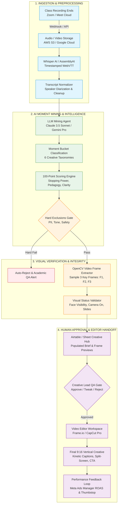
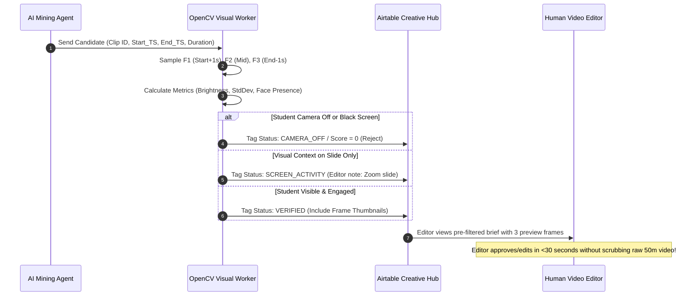

# Deliverable B: End-to-End Workflow Architecture & SOP

**Author:** Harshit (AI Program Manager, Marketing)  
**System:** Bambinos AI Creative Mining & Production Engine (ACM-PE)  
**Pipeline Velocity:** 10x Speedup (from 50 min manual review to <3 min editor review per class)

---

## 1. High-Level Pipeline Architecture

The pipeline processes live Zoom/Google Meet recordings through an automated 10-stage assembly line with automated gates and human-in-the-loop quality controls:

---

## 2. Production Tooling Stack Matrix

We intentionally select a robust, cost-effective, low-code/AI stack designed for marketing operations without requiring custom backend engineering:

| Pipeline Stage | Primary Tool Selected | Fallback / Alternative | Rationale & Operational Role |
| :--- | :--- | :--- | :--- |
| **Ingestion & Storage** | **AWS S3 / Google Cloud Storage** | Zoom Cloud Storage | Immutable, secure cloud storage with pre-signed URLs for automated downstream processing. |
| **Transcription & Diarization** | **Whisper API / AssemblyAI** | Deepgram Nova-2 | Generates accurate millisecond-timestamped WebVTT with speaker diarization across diverse accents (Indian, US, UK, Middle East). |
| **Workflow Orchestration** | **n8n (Self-hosted or Cloud)** | Make.com / Zapier | Enterprise-grade webhook handling, branching logic, JSON transformations, and API orchestration at 1/10th the cost of Zapier. |
| **LLM Mining & Scoring** | **Claude 3.5 Sonnet / Gemini 1.5 Pro** | GPT-4o | Massive context window (handles entire 50-minute transcripts in a single call), superior nuance in detecting teacher tone and pedantic shaming. |
| **Visual Verification Engine** | **Python + OpenCV Worker** | Cloudinary / Twelve Labs | Automated lightweight sampling of 3 frames per moment; checks webcam brightness, face presence, and slide variance in <2 seconds per clip. |
| **Creative Hub & Database** | **Airtable (Enterprise)** | Google Sheets + AppSheet | Relational database linking Class IDs, Video URLs, Moment Briefs, Visual Status, Editor Status, and Performance Meta KPIs. |
| **Video Editing & Assembly** | **CapCut Pro / Adobe Premiere** | OpusClip / Descript | Rapid 9:16 vertical re-framing, auto-caption generation with dynamic styling, split-screen templates, and branding overlays. |
| **Review & Handoff** | **Frame.io / Airtable Interfaces** | Google Drive Comments | Frame-accurate creative review, timestamped annotations, and one-click editor approvals. |

---

## 3. Solving the "Audio vs. Visual" Gap

### The Core Vulnerability
A transcript records *phonemes and text*, but cannot see:
- When a child's camera is turned off, pointing at the ceiling, or blacked out.
- When an animated visual exercise (e.g., interactive digital whiteboard, animated story slide) makes dialogue comprehensible that would otherwise sound abstract.
- When a child looks miserable despite polite words ("Yes ma'am").
- When a teacher makes high-energy physical gestures (waving hands, miming an animal) that drive thumbstop rate.

### The 4-Step Automated Visual Verification Protocol

### Visual Verification Status Taxonomy
1. **`VERIFIED` (Green):**
   - Student face clearly detected, camera brightly lit, natural head/hand movement.
   - Ready for standard 9:16 split-screen edit.
2. **`SCREEN_ACTIVITY` (Yellow):**
   - Key action occurs on the shared screen (digital puzzle, math diagram, story graphic).
   - Editor instruction: Re-frame slide as full 9:16 canvas with student webcam in a circular bottom-right picture-in-picture (PiP).
3. **`CAMERA_OFF` (Red):**
   - Student webcam is dark, static, or disabled.
   - Action: Auto-rejected for direct video ads; flagged for potential voiceover/testimonial animation if audio is extraordinary.
4. **`UNVERIFIED` (Orange):**
   - Ambiguity in frame extraction; flagged for a 5-second human scrub before opening Premiere/CapCut.
5. **`REJECTED` (Black):**
   - Inappropriate background, camera pointing at ceiling/wall, or visual distress detected.

---

## 4. Standard Operating Procedure (SOP): Video Editor Handoff

### Editor Workflow & SLA
- **Target SLA:** 24 hours from Class Session to Published Short-Form Ad.
- **Editor Review Time:** < 2 minutes per brief (down from 45 minutes of raw scrubbing).

### The 9:16 Vertical Creative Template Spec:
1. **Canvas Aspect Ratio:** 9:16 (1080x1920 pixels) optimized for Instagram Reels, Meta Ads, and YouTube Shorts.
2. **Split-Screen Layout:**
   - **Top 55%:** Teacher interaction or high-contrast presentation slide/digital activity.
   - **Bottom 45%:** Child face, expressive reactions, and live verbal participation.
3. **The 3-Second Visual Hook (Thumbstop):**
   - Large bold text overlay in top-third: High-contrast yellow/white sans-serif font (Montserrat / The Bold Font) with black drop shadow.
   - Hook text must match the brief's opening line (e.g., *"How 6-year-olds connect with Sanskrit"*).
4. **Subtitles & Kinetic Captions (Sound-Off Optimization):**
   - Word-by-word synchronized animated captions centered in the lower-middle screen.
   - Key emotional words highlighted in brand green/gold.
5. **Audio Mastering:**
   - Teacher and student audio normalized to -14 LUFS.
   - Background hum removed via Adobe Podcast AI / CapCut voice enhancement.
   - Gentle, upbeat, royalty-free acoustic/lo-fi background music ducked at -24 dB beneath dialogue.
6. **Closing Call-to-Action (Final 3 Seconds):**
   - Bambinos.live logo + *"Book Your Child's Free Trial Class"* CTA banner.
   - Visual cue pointing to the caption link / "Sign Up" button.

